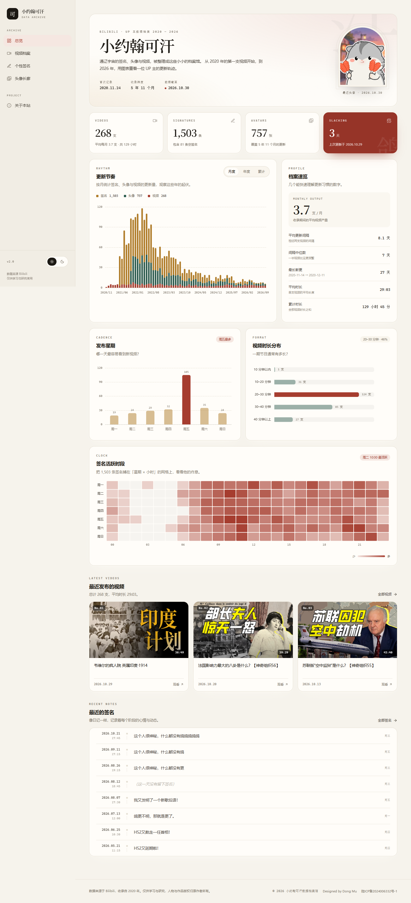
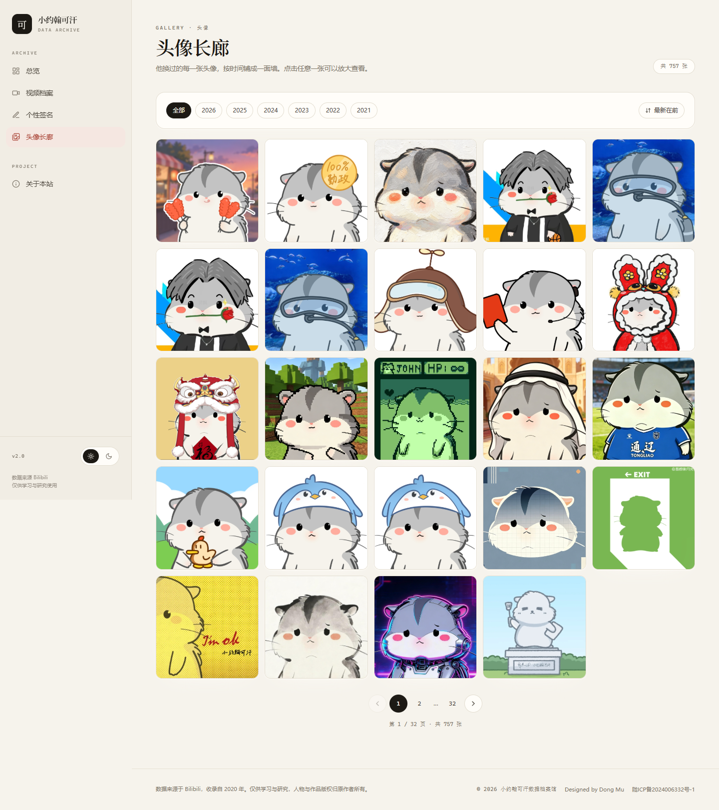
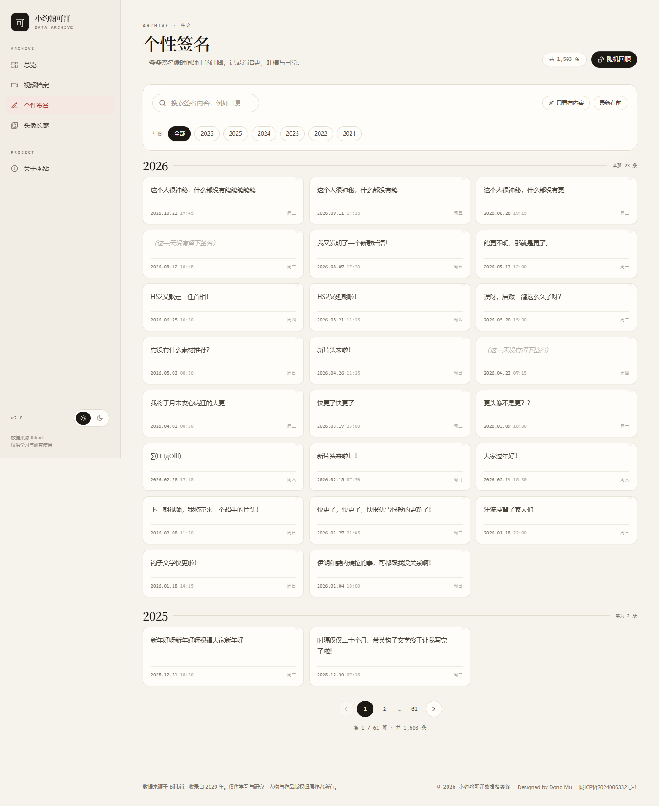
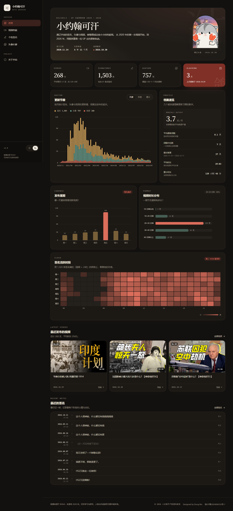
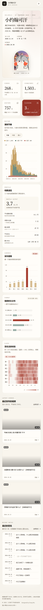

# 小约翰可汗 · 数据档案馆

把一位 UP 主从 2020 年至今的视频、签名与头像，做成一座可以翻阅的档案馆。



旧版本是一个「Node.js + MySQL + Bootstrap DataTables」的表格页：能用，但界面朴素、SQL 直接拼接字符串、没有错误处理，数据还因为 latin1 / UTF-8 混用而大面积乱码。

这个版本在保留全部数据的前提下重做了视觉与工程：指标在服务端聚合，图表在客户端渲染，前端用 React + TypeScript 重写，数据落到免安装的 SQLite；同时重写了 Python 采集脚本，让它与 Node 共用同一个数据库文件，定时任务写入后页面即可读到新数据，并顺手修复了历史乱码。

---

## 参观链接
**[小约翰可汗·数据档案馆](https://khan.dgweb.top/)**

## 目录

- [功能](#功能)
- [技术栈](#技术栈)
- [快速开始](#快速开始)
- [数据更新（Python 爬虫）](#数据更新python-爬虫)
- [常用脚本](#常用脚本)
- [API](#api)
- [数据说明](#数据说明)
- [设计说明](#设计说明)
- [与旧版对比](#与旧版对比)
- [目录结构](#目录结构)
- [部署](#部署)
- [致谢](#致谢)

## 功能

- **总览仪表盘**：视频 / 签名 / 头像总量、距上次更新天数、平均更新间隔、时长分布与「鸽王指数」。
- **四张图表**：月度 / 年度 / 累计更新节奏、发布星期分布、视频时长分布、签名「星期 × 小时」热力图，全部支持深色模式与响应式。
- **视频档案**：标题搜索、年份筛选、按时间 / 时长 / 标题排序、分页，封面点击直达 B 站。
- **个性签名**：关键词搜索、年份筛选、只看有内容、按年份分组的「留言墙」，以及随机回顾。
- **头像长廊**：按年份浏览、灯箱预览、方向键切换。
- **体验细节**：深色模式、加载骨架、空状态、错误重试、键盘可达、`prefers-reduced-motion` 支持。
- **定时更新**：Python 脚本增量抓取签名 / 头像 / 视频，与 Node 共用 SQLite；新增头像无需重新构建前端。
- **零配置启动**：首次启动自动建表并导入种子数据，不需要本机安装 MySQL。

<table>
  <tr>
    <td></td>
    <td></td>
  </tr>
  <tr>
    <td></td>
    <td></td>
  </tr>
</table>

<p>
  
</p>

## 技术栈

| 层 | 选型 | 说明 |
| --- | --- | --- |
| 前端 | React 18 · TypeScript · Vite | 组件化 + 严格类型，构建快 |
| 样式 | Tailwind CSS | 设计令牌集中在 CSS 变量，深浅色一键切换 |
| 图表 | ECharts 5（按需引入） | 自定义配色、渐变、tooltip，体积比全量包小一半 |
| 数据请求 | TanStack Query | 缓存、加载态、失败重试、翻页保留旧数据 |
| 后端 | Node.js 20 · Express | 分层：Router → Repository → SQL |
| 校验 | Zod | 查询参数白名单，排序字段只能来自枚举 |
| 数据库 | SQLite（better-sqlite3 原生驱动） | 单文件、免装数据库服务；WAL 模式支持 Python 同时读写 |
| 采集 | Python 3.9+ · requests | 与 Node 共用数据库文件；签名 / 头像 / 视频增量更新 |
| 日志 | Pino | 结构化日志，生产环境只记录 API 请求 |

> 为什么换成原生 `better-sqlite3`？一开始用的是 WASM 版 SQLite，免编译，但它的锁机制和 Python 原生 `sqlite3` 不兼容——爬虫写入时 Node 会读失败。原生驱动使用标准文件锁 + WAL，Python 和 Node 可以同时读写同一个库，这才满足「定时爬虫 + 常驻站点」的场景。
>
> 代价是安装时需要预编译包或编译工具；Linux 部署可参考 [DEPLOY.md](John-Khan-Data-Studio/DEPLOY.md) 的镜像与编译说明。

数据流：

```
B 站接口
   │  python/main.py（增量、去重、乱码修复、图片原子写入）
   ▼
SQLite（server/data/khan.db，WAL） ◄── Node 常驻读取
   │                                  │
   │  /api/*：Zod 校验 → 参数化 SQL → JSON
   ▼                                  ▼
web/public/images（头像）        React + TanStack Query + ECharts
```

旧数据的迁移路径（二选一）：

```
旧 MySQL 库 ──python/migrate_from_mysql.py──► SQLite
旧 MySQL dump ──npm run import──► data/seed/*.json ──npm run seed──► SQLite
```

> Windows 下 esbuild 偶尔会因为系统临时目录权限报 `Access is denied`，因此 `web` 的构建命令走 `scripts/build-web.mjs`，把临时目录固定到项目内的 `.cache/`。在 Linux / macOS 上同样适用。


## 快速开始

要求：Node.js >= 20；如需定时抓取，另需 Python 3.9+。

```bash
npm install

# 开发：前端 5173（/api 代理到 4000），后端 4000
npm run dev

# 生产：构建前端 + 编译后端，由 4000 端口统一托管
npm run build
npm start
```

> `better-sqlite3` 是原生模块。国内网络如果下载预编译包很慢，按 [DEPLOY.md](John-Khan-Data-Studio/DEPLOY.md) 设置 npmmirror 镜像；没有预编译包时安装 `build-essential` 后执行 `npm rebuild better-sqlite3 --build-from-source`。
>
> **CentOS 7 注意**：系统 glibc 2.17 无法运行官方 Node 18/20/22（需要 glibc 2.28+）。请使用 [DEPLOY.md 的 Docker 方案](John-Khan-Data-Studio/DEPLOY.md)（已提供 `Dockerfile` 和 `docker-compose.yml`），或升级到 AlmaLinux/Rocky/Ubuntu 后再按常规流程部署。

首次启动会自动建表，并从 `data/seed/*.json` 写入 **268 支视频、1,503 条签名、757 个头像**（截至 2026-10）。

可选：如果你的 IP 配置不同，复制 `.env.example` 为 `.env` 后修改端口与路径。

## 数据更新（Python 爬虫）

Python 脚本与 Node 共用 `server/data/khan.db`（WAL 模式），增量写入，Node 无需重启即可读到新数据。

```bash
cd python
python3 -m venv venv
source venv/bin/activate          # Windows: venv\Scripts\activate
pip install -r requirements.txt
cp .env.example .env

python main.py check              # 检查数据库、图片目录、Cookie
python main.py all                # 签名 + 头像 + 视频
python main.py videos --backfill  # 首次上线补齐历史视频
```

- 完整说明见 [python/README.md](John-Khan-Data-Studio/python/README.md)；
- 视频接口被 B 站风控（`-352` / `412`）时，在 `python/.env` 配置 `KHAN_COOKIE`；
- 宝塔面板从零到上线的完整步骤见 [DEPLOY.md](John-Khan-Data-Studio/DEPLOY.md)。

## 常用脚本

| 命令 | 作用 |
| --- | --- |
| `npm run dev` | 同时启动 API 与 Vite 开发服务器 |
| `npm run build` | 构建前端并编译后端 TypeScript |
| `npm start` | 以生产模式启动（需先 build） |
| `npm run seed` | 清空并用 `data/seed` 重新灌库 |
| `npm run import` | 从 MySQL dump 重新生成种子 JSON（兼容新旧格式，含乱码修复） |
| `npm test` | 运行后端 API 测试（Node Test Runner + Supertest） |
| `npm run test:python` | 运行 Python 单元测试（乱码修复、解析、数据库） |
| `npm run typecheck` | 前后端 TypeScript 类型检查 |
| `npm run capture` | 用本机 Chrome 逐页截图到 `docs/screenshots`（视觉回归用） |
| `python main.py all` | 增量抓取签名 / 头像 / 视频（需先激活 venv） |
| `python main.py videos --backfill` | 翻页补齐历史视频 |
| `python migrate_from_mysql.py` | 旧 MySQL → SQLite 一次性迁移 |

`npm run import` 默认读取 `data/legacy/khan.sql`（最新 dump），也兼容旧版无列名的 dump，并会自动修复历史乱码。也可以传入自定义路径：

```bash
npm run import -- ../path/to/dump.sql
```

## API

所有接口返回 JSON；列表统一为 `{ data, meta }`，错误统一为 `{ error: { code, message, details? } }`。

| 方法 | 路径 | 参数 | 说明 |
| --- | --- | --- | --- |
| GET | `/api/health` | — | 服务与数据库状态 |
| GET | `/api/videos` | `page` `pageSize` `q` `year` `sort` `order` | 视频列表 |
| GET | `/api/signs` | `page` `pageSize` `q` `year` `order` `withContent` | 签名列表 |
| GET | `/api/signs/random` | — | 随机一条非空签名 |
| GET | `/api/avatars` | `page` `pageSize` `year` `order` | 头像列表 |
| GET | `/api/stats/overview` | — | 总览所需的全部聚合数据 |
| GET | `/api/stats/filters` | — | 各模块可选年份 |

约束：`pageSize` 上限 100；`sort` 只接受枚举值；`year` 限定在 2000–2100；搜索关键词最长 120 字符。所有 SQL 均使用占位符，排序字段来自白名单。

## 数据说明

- **来源**：视频、签名与头像来自 B 站 UP 主[小约翰可汗](https://space.bilibili.com/23947287)，由 Python 脚本抓取；早期整理与思路来自[怕刺](https://pa.ci/137.html)。
- **时间范围**：种子数据为 `2020-11-14`（首支视频）至 `2026-10-30`（最新头像）；运行 Python 爬虫后会持续增量更新。
- **乱码修复**：旧库表结构是 `latin1`，写入的却是 UTF-8 字节。导入脚本会按 GBK → UTF-8 还原，例如 `涓夊浗` → `三国`；对已经是正常 UTF-8 的新 dump 则自动跳过。
- **统计口径**：签名包含 81 条留空记录，页面会单独标注；视频时长统一换算为秒；「距上次更新」按服务器当前时间计算，因此会随时间增长。
- **封面**：视频封面是 B 站外链，可能被防盗链或网络环境拦截，此时会降级为按标题生成的渐变占位图，版面不会塌。

## 设计说明

- **视觉概念**：纸质档案。暖米色纸张、墨色正文、印章红作为强调色，中文标题用宋体，数字与日期用等宽字体；深色模式切换为「夜读档案」。
- **图表**：ECharts 主题由同一组 CSS 变量生成，柱状图使用圆角与渐变，热力图按分位数映射透明度；tooltip 是自绘 HTML 卡片，和站点风格一致。
- **交互**：筛选条件写入 URL（可分享、可回退）；翻页保留上一页数据避免闪烁；头像灯箱支持 `←` / `→` / `Esc`。
- **可访问性**：图表带 `aria-label`，灯箱按钮有可读名称，焦点环统一，遵循 `prefers-reduced-motion`。

## 与旧版对比

| 方面 | 旧版 | 新版 |
| --- | --- | --- |
| 前端 | Bootstrap 5 + jQuery + DataTables | React 18 + TypeScript + Tailwind + ECharts |
| 架构 | `index.js` + 4 个 controller，SQL 直接拼接 | Router → Repository → SQL 分层，参数化查询 |
| 校验 | 无 | Zod schema + 排序白名单 |
| 错误处理 | 基本没有，异常会挂起请求 | 统一错误码 / 错误结构 + 结构化日志 |
| 数据库 | 本机 MySQL，需手动建库导数 | SQLite（原生驱动），首次启动自动建表灌数 |
| 采集脚本 | 两个 `pymysql` 脚本：硬编码 Cookie / Mac 路径，只抓最新 1 条 | 统一 CLI：增量去重、多页回补、图片原子写入、错误可诊断 |
| 乱码 | 页面直接显示乱码 | 导入/迁移时按 GBK → UTF-8 修复 |
| 图表 | 全部依赖 `Charts` 预聚合表（旧 dump 里甚至缺失） | 实时 SQL 聚合，无需额外表 |
| 视觉 | 表格 + 固定页脚 | 仪表盘、卡片墙、灯箱、深色模式、响应式 |

## 目录结构

```
john-khan-data-studio/
├─ Dockerfile               # CentOS 7 / glibc 2.17 用 Docker 运行
├─ docker-compose.yml       # 挂载 SQLite 与头像目录
├─ data/seed/               # 由 dump 生成的 JSON 种子（视频 / 签名 / 头像）
├─ docs/screenshots/        # 视觉验收截图
├─ scripts/
│  ├─ import-mysql-dump.mjs    # 解析新旧 dump、修复乱码、导出种子
│  ├─ build-web.mjs           # 前端构建（固定临时目录）
│  └─ capture.mjs             # 无头 Chrome 截图与前端错误检查
├─ server/
│  ├─ src/
│  │  ├─ config/            # 环境变量与路径
│  │  ├─ db/                # SQLite 封装、建表、种子写入
│  │  ├─ middleware/        # 错误处理、缓存
│  │  ├─ modules/           # videos / signs / avatars / stats
│  │  ├─ shared/            # 错误类型、分页、参数校验
│  │  ├─ app.ts             # Express 应用装配
│  │  └─ index.ts           # 启动与优雅退出
│  └─ test/api.test.ts      # 14 条 API 测试
├─ python/
│  ├─ main.py               # 采集 CLI：signs / avatars / videos / all / check
│  ├─ khan_scraper/         # 配置、数据库、B 站接口、下载、迁移
│  ├─ migrate_from_mysql.py # 旧 MySQL 一次性迁移
│  ├─ run_cron.sh           # 宝塔计划任务包装（flock 防重入）
│  └─ tests/                # 不依赖网络的单元测试
└─ web/
   ├─ public/images/        # 头像原图（Python 写入，Node 托管）
   └─ src/
      ├─ api/               # 类型化请求与查询 hooks
      ├─ components/        # 图表、卡片、布局、UI 原语
      ├─ pages/             # 总览、视频、签名、头像、关于
      └─ lib/               # 格式化、主题、URL 状态
```

## 部署

完整的宝塔面板部署流程（Node 启动、Nginx 反代、SSL、Python venv、计划任务、MySQL 迁移、备份恢复、故障排查）见 **[DEPLOY.md](John-Khan-Data-Studio/DEPLOY.md)**。

最短路径：

```bash
npm ci && npm run build
npm run seed                      # 或先迁移旧 MySQL
sudo -u www pm2 start npm --name khan-site -- start

cd python && python3 -m venv venv && source venv/bin/activate
pip install -r requirements.txt && cp .env.example .env
./venv/bin/python main.py videos --backfill
```

## 致谢

- 人物、视频与头像版权归[小约翰可汗](https://space.bilibili.com/23947287)及 Bilibili 所有。
- 数据与部分采集思路来自[怕刺](https://pa.ci/137.html)的整理。
- 本项目仅用于学习与研究，不提供任何商业服务；如涉及版权问题请联系删除。

---

如果这个小站让你多看了一眼数据，那就达到目的了。
